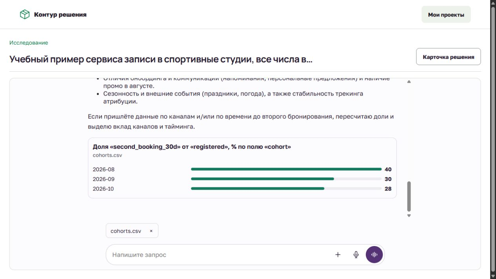
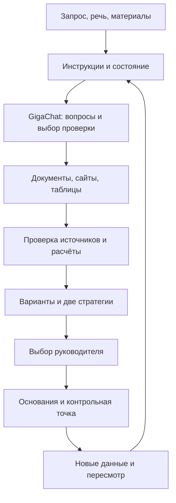

# Контур решения · Стратег Фабрики продуктов

Помощник руководителя цифрового продукта: от неясного вопроса до продуктовой и коммуникационной стратегии с основаниями, альтернативами и планом проверки. После выбора работа продолжается — сохраняются решение, материалы, ответственный и условие пересмотра.

Я делаю проект для трека «Стратег Фабрики продуктов» МегаФона. Мне было важно собрать рабочее пространство для исследования: с исходными материалами, проверяемыми расчётами, возможностью остановиться и вернуться к задаче. Сайт добавляет переписку, диктовку и голосовой разговор. Сам агент остаётся папкой с инструкциями, методиками, знаниями и инструментами, которую можно открыть в Codex или Cursor.

## Материалы для жюри · официальный бриф

Демонстрация обновлена по опубликованному брифу **«Связь для близких и собственных устройств»**. Это вымышленный оператор; учебные числа не являются данными МегаФона.

| Что отправить | Готовый материал |
| --- | --- |
| Репозиторий и запуск | Этот репозиторий; публичный сервис и самостоятельный запуск описаны ниже |
| Демонстрационный проект | [Стратегия из пяти частей](examples/megafon-brief/strategy.md) · [PDF](output/pdf/official-strategy.pdf) · [Читаемая веб-версия](https://decision-contour.vercel.app/submission/official-strategy.html) |
| Исходные материалы и ход работы | [Оригинальный бриф](examples/megafon-brief/materials/official-brief.pdf) · [Запросы и ответы](examples/megafon-brief/) · [Расчёты](examples/megafon-brief/calculate.mjs) |
| Описание работы со скриншотами | [Готовый PDF](output/pdf/work-description.pdf) · [Текст описания](docs/submission/work-description.md) |
| Видео до 10 минут | [Демонстрация на Яндекс Диске, 1 мин 50 с](https://disk.yandex.ru/i/5J_mblxmcZl_lA) · [Сценарий и способ записи](docs/submission/video-script.md) |

Перед прогоном выполнена [сверка с критериями](docs/submission/criteria-audit.md). Все 11 страниц переданы агенту в явном режиме полного чтения. Сохранены покрытие чтения, фактические ответы, токены, время и продолжение после остановки сервера. [Сводка прогона](examples/megafon-brief/run-summary.json) и [реестр ошибок и исправлений](examples/megafon-brief/review.md) доступны вместе с результатом.

**[Повторная проверка всех требований сдачи и четырёх критериев](docs/submission/requirements-review.md).** В демонстрационную стратегию добавлены скриншоты самого прогона и подтверждения семи аспектов описания работы. Изображения в веб-версии и PDF открываются в исходном размере. Ролик длится 1 мин 50 с; соответствие проверено по содержанию всех этапов, минимальной длительности в переданных требованиях нет.

Итоговая стратегия прошла проверку и редактуру с Codex. Она не выдаётся за один безошибочный ответ модели. В исходных ответах найдены неверные пороги, единицы и сроки; их можно увидеть и сравнить с исправленным документом. Условный сценарий даёт 279,5 млн руб. против цели 285 млн: дефицит сохранён, а не закрыт вымышленной выручкой. Реального пилота и доказанного спроса не было.


## Как посмотреть проект

**Быстрый просмотр для жюри: [открыть «Контур решения»](https://decision-contour.vercel.app).** Для размещённой демонстрации не нужно выпускать API-ключ, устанавливать Python или скачивать модели. Ключ владельца хранится на сервере. Потребуется только разрешить микрофон, если вы хотите проверить голос.

1. Нажмите «Начать исследование» и опишите продуктовую задачу.
2. Прикрепите собственную таблицу или документ, добавьте разрешённую публичную ссылку. Для первого вопроса материалы необязательны: помощник предложит проверку и обозначит, чего пока не знает.
3. Справа от поля ввода доступны диктовка и разговор. Во время разговора чат остаётся открытым: можно отправить ссылку или файл, выключить микрофон и остановить ответ.
4. Проверьте варианты, основания и ограничения. Существенный выбор остаётся за руководителем; его можно сохранить в карточке решения и вернуться с новыми данными.

Бесплатная среда речи выделяется по требованию. После простоя ей может потребоваться время на запуск; доступность и скорость круглосуточно не гарантируются. Используется бесплатная квота GigaChat владельца. Платные ресурсы и автоматическая покупка квоты не включены. При исчерпании лимита показывается ошибка, а не вымышленный ответ.

GitHub хранит исходный код и воспроизводимый вариант установки. Страница репозитория сама по себе не запускает модели. Ниже оставлена полная инструкция самостоятельного запуска: она нужна, если вы хотите проверить устройство агента, собственные доступы и работу вне демонстрационного размещения.

Есть два способа работы:

- В редакторе: откройте папку в Codex / Cursor, попросите прочитать [AGENTS.md](AGENTS.md), затем задайте продуктовый вопрос. Модель и доступы используются из вашего редактора. CLI-инструменты репозитория читают материалы и сохраняют состояние.
- В браузере: запустите собранный сайт и API. Для анализа используется GigaChat, для разговора и диктовки — отдельные речевые процессы на компьютере проверяющего. Компьютер автора после установки не требуется.

Для знакомства доступны [готовый учебный разбор](examples/procurement/result.md), [пересмотр решения](examples/procurement/review.md), [бриф](examples/procurement/brief.txt) и [исходная таблица](examples/procurement/cohorts.csv). Это сохранённые результаты проверки. Новый ответ на ваш вопрос генерируется подключённой моделью.

В размещённой версии дополнительно проверен [новый кейс повторной записи в спортивные студии](examples/studio-retention/brief.md): процент отсутствовал в исходном CSV, агент выбирал числитель и знаменатель, затем код вычислял 40%, 30% и 28%. [Сохранённый ответ с замечаниями](examples/studio-retention/result.md) показывает и результат, и ограничения сгенерированной стратегии. Это вымышленные данные, не статистика МегаФона.

## Что происходит с задачей

1. Агент уточняет цель, предстоящее решение, ограничения и доступные данные. Вопрос должен менять следующий шаг исследования.
2. Читает документы, таблицы и разрешённые публичные страницы. У существенного наблюдения остаётся источник и фрагмент. Недоступный источник отмечается ошибкой.
3. Выбирает вопросы исследования и расчёты. Проверяет числитель, знаменатель, проценты, периоды и пропуски. Совпадение во времени не объявляется причиной изменения.
4. Сравнивает разные направления, включая сохранение текущего подхода и закрытие направления. Для каждого требуется сильное возражение.
5. Связывает продуктовую стратегию с коммуникационной: кому помогаем, что меняем, от чего отказываемся, как объясняем пользу и чем подтверждаем обещание.
6. Формирует план проверки с метрикой, сравнением, сроком и нежелательными последствиями. Существенный выбор подтверждает руководитель.
7. Сохраняет основания. При новых данных проверяет условие пересмотра и предлагает следующее действие ответственному.

Проверки структуры, чисел и согласованности снижают число ошибок, но не превращают любой ответ модели в доказанный факт. Пробелы в данных остаются пробелами.

## Интерфейс и история


В ленте остаются запрос, ответ, графики и значимые предупреждения. Журнал инструментов, счётчики токенов и тариф не выводятся между сообщениями. Основания и сведения о выполнении сохраняются в API-ответе и контрольной точке для проверки исследования.

Справа от поля ввода находятся вложение файла, диктовка и начало разговора. Во время звонка доступны выключение микрофона, прерывание ответа и завершение. Можно продолжать писать и отправлять ссылки. Оба режима используют одну аналитическую модель и одно состояние проекта. Сфера показывает состояние разговора; анимация сама по себе не доказывает, что речь распознана. Распознанная реплика видна в чате.


На скриншоте проверочный вопрос отправлен текстом во время разговора, микрофон выключен, а интерфейс воспроизводит ответ. Это проверка совмещения чата и голосового режима; она не подменяет живое тестирование микрофона.



При первой установке нет подготовленных пользовательских чатов. Примеры лежат в `examples/` и не добавляются в «Мои проекты» автоматически. История браузера хранится в localStorage, вложения — в IndexedDB. Контрольные точки создаются в `cases/`, исключённой из Git.

На другом компьютере будут собственные хранилища. IP не используется для разделения истории: разные люди могут находиться за одним адресом. «Очистить историю» убирает проекты из списка этого браузера; предыдущий список сохраняется локально в `contour-projects-trash`. Кнопка не удаляет резервные дела с диска.

В публичной демонстрации каждый браузер получает отдельный подписанный сеанс. API-ключей в браузере нет, история других проверяющих не подмешивается. Это ограниченная демонстрационная поставка; промышленная многопользовательская эксплуатация не заявляется.

### Что сохраняется в разных вариантах запуска

| Возможность | По публичной ссылке | При самостоятельном запуске |
| --- | --- | --- |
| Диалог, файлы, изображения, ссылки, расчёты и графики | Через API на Vercel | Через локальный Node API |
| Разговор, диктовка и мужская озвучка | Вычисления на CPU ModelScope | Те же речевые модели на CPU вашей машины |
| История, вложения и карточка решения | В хранилище этого браузера | В браузере и контрольных точках дела |
| Продолжение в другом чате редактора, перенос материалов | Через самостоятельную папку агента | `checkpoint`, `resume`, папка `cases` |
| Постоянный фоновый пересмотр числовых условий | Не запускается после закрытия вкладки | Отдельно запущенный `agent/monitor.mjs` |

Сервер Vercel не пишет общую папку дел. Онлайн-история не является синхронизацией между устройствами. Для переноса дела и проверки фонового процесса используйте репозиторий. [Устройство размещения, параметры и ограничения](docs/cloud-deployment.md).

## Какие модели используются

| Роль | Проверочный профиль | Где работает |
| --- | --- | --- |
| Анализ, стратегии, диалог, разбор изображения | GigaChat-3-Ultra | API Сбера; ключ и доступная квота |
| Распознавание в разговоре | Русский Zipformer INT8 2025-04-20, sherpa-onnx | ModelScope CPU / CPU проверяющего |
| Диктовка | Qwen3-ASR-0.6B-Q8_0.gguf, transcribe-cpp | ModelScope CPU / CPU проверяющего |
| Быстрая озвучка | Silero v5.6 ru, eugene, WAV 48 кГц | ModelScope CPU / CPU проверяющего |
| Расчёты, чтение материалов, память | Инструменты репозитория | Vercel API и браузер / самостоятельный Node.js |

Название `voice/qwen_voice.py` историческое: текущий быстрый голос генерирует Silero. В коде сохранены альтернативные ветви Qwen TTS, Piper и Ollama, но для стандартного профиля жюри они не нужны.

Веса GigaChat не скачиваются: модель вызывается через API. Доступ к Ultra определяется кабинетом владельца ключа и проверяется перед демонстрацией. [Документация модели](https://developers.sber.ru/docs/ru/gigachat/models/gigachat-3-ultra).

Qwen 2B и 4B проверялись локально, однако не дали достаточного качества на новом стратегическом кейсе. Основной профиль поэтому использует GigaChat. Замена модели требует повторной приёмки, а не только изменения имени.

## Установка сайта и API

Проверочный профиль самостоятельной установки: Windows x64, Node.js 24, Python 3.11. Для Node-инструментов предусмотрен CI на Windows и Linux. Инструкция речи ниже рассчитана на Windows. Отдельный Linux Docker-профиль речи проверен на ModelScope; macOS не проверялась.

Нужны интернет для скачивания зависимостей и GigaChat, место для Python-окружений и весов, микрофон для живой проверки. GPU выбранному CPU-профилю не обязателен. Задержка зависит от процессора, диска, сети и очереди провайдера.

```powershell
npm install -g pnpm@11.25.0
pnpm install --frozen-lockfile
pnpm build
```

### Настройка GigaChat

1. Создайте проект GigaChat API и Authorization key по [инструкции для физлиц](https://developers.sber.ru/docs/ru/gigachat/individuals-quickstart). Подписка на пользовательский чат не подтверждает доступ API к нужной модели.
2. Создайте файл вне репозитория, например `D:/ContourSecrets/gigachat.env`, со строкой `GIGACHAT_AUTH_KEY=ваш_ключ`. Не публикуйте ключ.
3. Скопируйте [шаблон конфигурации](config/runtime.example.env) в `.env.local` в корне проекта и укажите свой путь:

```dotenv
CONTOUR_LLM_BACKEND=gigachat
GIGACHAT_MODEL=GigaChat-3-Ultra
CONTOUR_CREDENTIALS_FILE=D:/ContourSecrets/gigachat.env
PORT=5176
```

При необходимости задайте `GIGACHAT_CA_FILE` с путём к официальному CA-файлу из документации Сбера. Проверка TLS включена; отключать её не нужно.

Текстовый режим можно проверить до установки речи:

```powershell
pnpm start
```

Откройте **http://127.0.0.1:5176**. Это собранное приложение и API без Vite. Для редактирования интерфейса доступен `pnpm dev --port 5175`.

### Установка речи

Установите Python 3.11 с [официального сайта](https://www.python.org/downloads/). Выберите папку для окружений и весов на доступном диске. Пути автора повторять не требуется.

Ознакомьтесь с [лицензией Silero](https://github.com/snakers4/silero-models/blob/master/LICENSE). Этот голос нельзя автоматически считать разрешённым для коммерческого внедрения. Если условия подходят для вашей проверки:

```powershell
powershell -NoProfile -ExecutionPolicy Bypass -File voice/setup.ps1 `
  -AiRoot D:/ContourRuntime `
  -AcceptSileroLicense
```

Перед установкой проверьте `python --version`: нужна версия 3.11.x. Если установлено несколько версий, дополнительно передайте `-PythonPath` с полным путём к Python 3.11. `ExecutionPolicy Bypass` действует только для запущенного процесса и не меняет системную политику.

Скрипт создаёт два изолированных окружения, устанавливает [ASR-зависимости](voice/requirements-asr.txt) и [TTS-зависимости](voice/requirements-tts.txt), скачивает веса и сверяет SHA-256 с [проверочным профилем](agent/jury-runtime.json). Несовпадение останавливает установку. GGUF для диктовки — сборка сообщества handy-computer на основе Qwen ASR, это отдельный источник от официальных весов Qwen.

Нужные речевые веса занимают примерно 1,07 ГБ без библиотек. Полные PyTorch-веса Qwen ASR/TTS и Ollama 4B не загружаются. Окружения и архивы требуют дополнительного места.

```powershell
powershell -NoProfile -ExecutionPolicy Bypass -File voice/start.ps1 -AiRoot D:/ContourRuntime
Invoke-RestMethod http://127.0.0.1:9460/health
Invoke-RestMethod http://127.0.0.1:9461/health
node agent/verify-portability.mjs D:/ContourRuntime/models
```

Оба сервиса должны вернуть `ready: true`. Они слушают только localhost и должны работать всё время разговора. Журналы находятся в папке runtime. Обновите сайт, разрешите микрофон и проверьте сначала диктовку, затем содержательный разговор. Браузер и операционная система должны разрешать звуковое воспроизведение.

## Материалы и ограничения

| Материал | Обработка | Граница |
| --- | --- | --- |
| TXT, Markdown, DOCX | Извлечение текста | До 2 МБ; длинные документы читаются выбранными фрагментами, покрытие указывается |
| PDF | Текстовый слой | Скан требует отдельного OCR, который не заявлен |
| CSV, XLSX | Таблица, проверка долей, график | Первый лист XLSX; табличное представление и графики ограничены 40 строками |
| PNG, JPEG, WebP | Передача мультимодальной модели | Одно изображение на запрос; числа сверяются с оригиналом |
| Ссылка | Чтение публичной страницы | До трёх ссылок; без закрытых, локальных и требующих входа страниц |
| MP4, WebM в веб-чате | Четыре кадра с таймкодами → один коллаж → визуальная модель | До 2 МБ и 60 секунд; одно видео или изображение; звук не анализируется; кодек должен поддерживаться браузером |
| VTT, SRT | Расшифровка с таймкодами | Это анализ расшифровки, не всего видео |
| Голос | WAV → ASR → анализ → WAV | До 80 секунд на серверный фрагмент; разговор состоит из отдельных реплик |

В интерфейсе доступны до пяти файлов по 2 МБ; суммарно до 2,65 МБ за запрос. Ошибка чтения не должна скрываться под видом выполненного исследования.

Поиск использует каталог источников и переданные ссылки. Полный поиск всего интернета не заявлен. Короткое MP4/WebM в веб-чате разбирается по четырём кадрам: это выборочное визуальное наблюдение, а не просмотр каждого кадра. События между выбранными моментами могут быть пропущены. Звук не анализируется. Для CLI приложите скриншоты или VTT/SRT. Контрольный ролик, фактический ответ и повторные проверки опубликованной версии: [examples/video-check](examples/video-check/README.md).

## Архитектура и память



| Файл / папка | Назначение |
| --- | --- |
| AGENTS.md | Вход из редактора, правила исследования и продолжения |
| agent/instructions.md | Постоянные инструкции |
| agent/methods.md | Методические знания |
| agent/sources.json | Каталог открытых источников |
| server/materials.js | Документы, таблицы и публичные URL |
| server/research.js | Вопросы исследования и расчёт долей |
| server/strategy.js | Структура, проверка и исправление стратегического ответа |
| server/cases.js | Версии состояния и отдельные исходные материалы |
| server/monitor.js | Числовое условие пересмотра |
| voice/ | Речь и установка профиля |
| examples/ | Учебные материалы, результаты и тесты |

Контрольные точки накапливаются в `cases/<id>/checkpoints/`, материалы — в `cases/<id>/materials/`. При восстановлении проверяются путь, размер и хеш материала. Предыдущий ответ агента остаётся рабочей записью; фактом его делает исходное свидетельство.

```powershell
node agent/cli.mjs inspect examples/procurement/cohorts.csv
node agent/cli.mjs resume procurement-check
```

В новом чате редактора попросите прочитать AGENTS.md и продолжить нужное дело. Для переноса дела скопируйте всю его папку вместе с материалами. Реальные дела не публикуются автоматически.

### Поддержка после выбора

Карточка содержит выбор, основания, две стратегии, план проверки, ответственного, дату и условие пересмотра. Версии показывают изменения после новых сведений.

Монитор запускается с `pnpm start` или отдельно через `pnpm monitor`. Для дела явно включается `monitor.enabled`, задаётся `inbox` с CSV/XLSX в `cases/<id>/inbox/` и правило, например `Активация ниже 30%`. Пока процесс запущен, проверка работает и без открытого браузера. Автозапуск после перезагрузки ОС не настраивается.

Поддержан однозначный числовой порог для доли. Неоднозначный период или ошибка таблицы требуют человека. Уведомления хранятся в `monitorNotices` контрольной точки, повторы не создают дубль. Решение монитор не меняет. Центр уведомлений и универсальное качественное наблюдение за любыми сайтами не заявлены.

## Проверки и демонстрация

Без ключей и речевых весов:

```powershell
pnpm build
node agent/verify-analysis.mjs
node agent/verify-full-read.mjs
node agent/verify-workflow.mjs
node agent/verify-monitor.mjs
node agent/verify-config.mjs
node agent/verify-demo-access.mjs
node agent/verify-voice-text.mjs
```

Эти проверки включены в GitHub Actions для Windows и Linux. Они подтверждают сборку и поведение инструментов. Зелёный CI не является проверкой живого микрофона или экспертного качества стратегии.

При работающем приложении и доступе к модели:

```powershell
node examples/procurement/run.mjs http://127.0.0.1:5176
node examples/procurement/verify-image.mjs http://127.0.0.1:5176
node examples/procurement/verify-voice.mjs http://127.0.0.1:5176
```

Сквозной тест создаёт дело `procurement-check` с синтетическим выбором руководителя и пересмотром после новых данных. Не запускайте его поверх своего дела с тем же именем. Проверка речи использует синтезированную запись, не заменяет ваш микрофон. Для неё задайте `CONTOUR_VOICE_PYTHON` с путём к Python речевого окружения, если он отличается от указанного в скрипте.

| Проверка | Предмет проверки |
| --- | --- |
| Арифметика | Доли, нулевой знаменатель, несовпадение процента |
| Источники | Неверная цитата, недоступная ссылка, неполное чтение |
| Стратегия | Поля, варианты, возражения, ограничения обещаний |
| Память | Новый процесс, версии, конфликт сохранения |
| Материалы | Совпадение CSV/XLSX, отдельное хранение и хеш |
| Мониторинг | Порог, отсутствие дубля, ошибка и восстановление |
| Речь | Синтез → распознавание → ответ → синтез |

В кейсе закупок проверены 48/120 = 40%, 45/150 = 30%, изменение −10 процентных пунктов. Позднее 28/100 = 28% пересекло порог ниже 30%. Числа учебные, не являются данными МегаФона и не доказывают причинный эффект пилота.

В одном из прогонов подробный отчёт занял около 36,5 секунды. Отдельный короткий серверный вопрос — 2,392 секунды. Это разные задачи, не обещание постоянной задержки. Живой микрофон автор проверял отдельно и подтвердил содержательный звуковой ответ. Устройство жюри требует своей проверки.

### Проверка публичного размещения 20 ноября

Сайт проверен запросом без входа в Vercel: HTTP 200, анонимный сеанс создаётся автоматически. Подмена Origin отклоняется с HTTP 403. Короткий содержательный ответ через публичный API занял 3,57 секунды, чтение изображения с шестью числами — 3,60 секунды, чтение публичной страницы МегаФона с ответом — 14,79 секунды. Полный новый кейс с расчётом, тремя вариантами и обеими стратегиями — 36,30 секунды. Это отдельные наблюдения, не средние значения широкой выборки.

| Речевая проверка в облаке | Наблюдавшаяся задержка |
| --- | --- |
| Синтез короткой фразы, Silero Eugene 48 кГц | 2,48–3,72 с |
| Распознавание этой записи в разговорном режиме, Zipformer | 1,09–1,27 с |
| Диктовка той же записи, Qwen ASR | 19,11–22,81 с |

В этих измерениях использовалась синтезированная запись. Автор отдельно услышал ответ через микрофон публичного сайта и сообщил о паузах между фразами. Предварительная загрузка следующей фразы не дала заметного улучшения по его оценке. Поэтому озвучка переведена на один HTTP-поток: сервер готовит следующие аудиофрагменты, пока браузер воспроизводит предыдущий. Отдельное озвучивание короткого промежуточного вступления убрано. Качество и скорость ChatGPT Voice не заявляются.

При проверке 21 ноября первый аудиофрагмент пришёл через 6,56 секунды и содержал 6,55 секунды звука; второй — через 9,93 секунды от начала запроса. Он был получен до завершения первого. Это подтверждает, что доставка успевает подготовить продолжение, но не заменяет проверку звука на устройстве пользователя. Начальная задержка синтеза остаётся.

Текст обычного ответа передаётся дельтами и постепенно раскрывается в чате. Для аналитических отчётов промежуточный JSON и непроверенная стратегия не показываются: после проверки итоговый текст также раскрывается плавно. Старая история при открытии не перепечатывается. Учитывается `prefers-reduced-motion`; ручная прокрутка вверх останавливает автоматическое следование за ответом.

В голосовом режиме раскрытие нового ответа синхронизировано с началом воспроизведения. Это не ускорение самой LLM: ожидание генерации и синтеза остаётся. Для уменьшения сетевой нагрузки браузер получает MP3 128 кбит/с вместо несжатого WAV, с частотой 48 кГц и тем же голосом. Это сжатие с потерями; точное совпадение с исходным PCM не заявляется.

На одинаковых двух проверочных фразах объём аудио сократился с 628 844 и 691 244 байт до 105 260 и 115 628 байт — примерно в шесть раз. В отдельном прогоне сжатого потока первый фрагмент пришёл за 5,41 секунды, следующий — за 6,55 секунды от начала запроса; его доставка укладывалась во время звучания первого. Задержки разных запусков не являются изолированным сравнением производительности. [Протокол потока и браузерной проверки](docs/acceptance/stream-check-2026-11-21.json).

При параллельных прогонах GigaChat один раз вернул 429 на этапе планирования исследования. Такой отчёт остался черновиком. В новом кейсе также найдены спорные формулировки коммуникации: они сохранены с замечаниями, а не выданы за экспертно одобренный результат. Проверки структуры и арифметики не доказывают отсутствие всех ошибок модели. [Протокол облачной проверки](docs/acceptance/cloud-check-2026-11-20.json).

## Расходы и качество

В проверках использована доступная владельцу Freemium-квота GigaChat. Пакеты и тарифы кодом не покупаются. Нулевая доплата внутри квоты не означает бесплатность навсегда: условия и баланс проверяются в кабинете.

API возвращает время, инструменты и usage, если провайдер его передал. Полная стоимость также включает поиск, повторы, электроэнергию, размещение и ручную проверку. Полное сравнение с аналитиком или обычным чатом пока не измерено; преимущество в процентах не заявляется.

Проверка согласованности выполняется в том числе той же аналитической моделью. Это полезный дополнительный проход, но не независимая экспертиза. Перед коммерческим обязательством нужны проверенные данные и решение человека. Широкий независимый benchmark, нагрузочная приёмка и гарантия отсутствия галлюцинаций не заявляются.

## Данные и безопасность

- Только открытые источники и собственные разрешённые материалы. Закрытые данные МегаФона не нужны.
- Ключи вне Git; .env, cases, Python-окружения и веса не публикуются.
- Источник не может изменять постоянные инструкции. Команды из документов не исполняются.
- Проверяются публичность URL и размер материалов; локальные и приватные адреса читать нельзя.
- Изображение передаётся GigaChat и удаляется из временного хранилища после обработки. Ошибка удаления сообщается.
- Модельные интервью синтетические и не подтверждают спрос. Реальные требуют согласия и исключения персональных данных.
- Сервер привязан к 127.0.0.1. Не открывайте его в интернет как готовый многопользовательский backend.

## Соответствие заданию

| Требование | Реализация / свидетельство |
| --- | --- |
| Папка агента и инструменты | AGENTS.md, agent/, server/, CLI |
| Постановка и исследование | Вопросы, источники, проверки, пробелы |
| Разные варианты и возражения | Структура ответа и учебный разбор |
| Две согласованные стратегии | Аудитория, экономика, обещание, доказательство, каналы |
| План проверки | Метрика, сравнение, срок, нежелательные последствия |
| Продолжение | Контрольные точки и resume |
| После решения | Карточка, версии, новые сведения, числовой мониторинг |
| Удобство и прозрачность | Диалог и голос, остановка, журнал и источники в результатах |
| Экономичность | Время и доступный usage; неизвестные затраты указаны |

Это карта связи с заданием, не прогноз оценки. Дополнительные компоненты выбираются по пользе; число агентов или библиотек само по себе преимуществом не считается.

## Что осталось для окончательной подачи

1. Проверить опубликованные ссылки на оба PDF, демонстрационный проект и видео без входа в аккаунты.
2. По возможности повторить живой разговор на независимом устройстве. Новое окружение на машине автора не равно другой машине.
3. Прикрепить комплект капитаном через «Моя работа» и отправить заявку. Репозиторий сам по себе не отправляет её.

## Материалы и благодарности

Это не официальный продукт МегаФона. Одобрение компании не заявляется. Источники визуальных материалов — [megafon-sources.md](megafon-sources.md). Права на изображения, видео и логотипы сохраняются за правообладателями; их присутствие в учебном проекте не предоставляет коммерческую лицензию.

Оригинальные Network Lines и Image Flipper предоставлены из OriginKit. При распространении нужно учитывать условия их лицензии; авторские пометки сохранены. Для визуальной правки использован [Unslop](https://github.com/heydamir/unslop), Damir Sokolovsky, CC BY 4.0.

## Проверка передачи через GitHub · 19 ноября 2026

[GitHub Actions: успешный прогон на Windows и Ubuntu](https://github.com/blad3r81/contour-product-strategist/actions/runs/44551488998). Проверен код коммита `fe679ef2aa9f108b8083e3a17b84899bda12df1c`. После публикации репозиторий заново клонирован в отдельную папку, зависимости установлены по lockfile, выполнены сборка и проверки инструментов. Затем запущены реальная GigaChat и речь из новых Python-окружений с отдельно загруженными весами.

| Проверка после клонирования | Наблюдаемый результат |
| --- | --- |
| Сквозной кейс закупок | Все проверки скрипта прошли; отчёт за 29,829 с, график 40% → 30%, сильные возражения и две стратегии |
| Пауза и продолжение | Восстановлено решение; 28/100 = 28% пересекло порог 30%, предыдущий выбор сохранён |
| Изображение таблицы | Распознаны обе строки, шесть числовых значений; 2,66 с |
| Голосовая цепочка | Zipformer 0,886 с → содержательный ответ 2,799 с → Silero 0,971 с |
| Диктовка Qwen ASR | Первый вызов 29,06 с, повторный 7,86 с; осталась грамматическая ошибка в слове «пользователей» |

Подробные [машиночитаемые результаты](docs/acceptance/github-check-2026-11-19.json) сохраняют границы этих проверок. Время голосовой цепочки измерено после отправки готовой записи; браузерная пауза, микрофон и воспроизведение на устройстве жюри в эти числа не входят. Это проверка на той же физической машине с новым окружением. Во время подготовки исправлены кодировка установщика PowerShell и разрешение установочного скрипта esbuild; проблемы скачивания весов не скрывались под видом успешной установки.


## Если запуск отличается от ожидаемого

| Симптом | Что проверить |
| --- | --- |
| Нет кнопок диктовки и разговора | Оба речевых процесса запущены, их `/health` возвращает `ready: true`; после запуска обновите страницу |
| `ready: false` | Дождитесь загрузки модели; при затянувшемся старте смотрите `qwen-asr-error.log` и `qwen-tts-error.log` в своей папке runtime |
| Текст пришёл, звука нет | Разрешено воспроизведение, вкладка не заглушена, выбран правильный выход звука; `/speak` доступен |
| Микрофон не включается | Разрешение браузера и ОС, корректное входное устройство; открывайте localhost или HTTPS |
| Ошибка авторизации GigaChat | Нужен Authorization key проекта API, а не истёкший Access token; проверьте доступность Ultra и квоту |
| Ошибка сертификата | Следуйте [инструкции Сбера](https://developers.sber.ru/docs/ru/gigachat/certificates) и укажите `GIGACHAT_CA_FILE` в `.env.local`; проверка TLS должна оставаться включённой |
| Запрос не проходит в сети организации | Нужен исходящий HTTPS к `api.giga.chat:443` и `ngw.devices.sberbank.ru:9443`; установке также нужны PyPI, PyTorch, GitHub и Hugging Face с их CDN |
| Установка остановилась на SHA-256 | Не используйте непроверенные веса. Удалять рабочий профиль или отключать сверку не требуется; проверьте загрузку и источник |

Для отдельной проверки речи без ключа GigaChat после запуска процессов доступна команда `node agent/verify-speech.mjs`. Она прогоняет синтез, разговорное распознавание и диктовку на синтетической записи. Независимая установка на Windows-машине GitHub запускается вручную через Actions → «Речь на независимой Windows-машине» → Run workflow. Она не получает пользовательский API-ключ.

### Независимая проверка речи на GitHub

[Успешный запуск на отдельной Windows-машине GitHub](https://github.com/blad3r81/contour-product-strategist/actions/runs/44554553492) установил Python-окружения и загрузил проверенные веса с нуля. В синтетическом тесте получены Silero 48 кГц за 0,14 с, Zipformer за 0,11 с и диктовка Qwen ASR за 2,23 с. Это измерения конкретного сервера, не обещание скорости на любом компьютере. В распознавании разговорной реплики осталось отличие окончания слова.

[Полный результат и границы проверки](docs/acceptance/voice-ci-2026-11-19.json). Первый запуск завершился ошибкой: процессы, запущенные отдельным шагом, были недоступны следующему шагу. Запуск и проверка объединены, повторный прогон прошёл. Ключ GigaChat на GitHub не передавался. Микрофон и воспроизведение в браузере пользователя этим тестом не подтверждаются.

При дополнительной проверке исправлены выбор режима для вопросов о необходимых вводных и явная ошибка при отсутствии ключа выбранного GigaChat. Короткий вопрос о данных больше не запускает полный стратегический отчёт; отдельный тест конфигурации проверяет, что локальная модель не подставляется незаметно. Служебная разметка клиентского черновика проверяется и при опечатке модели в маркере.
