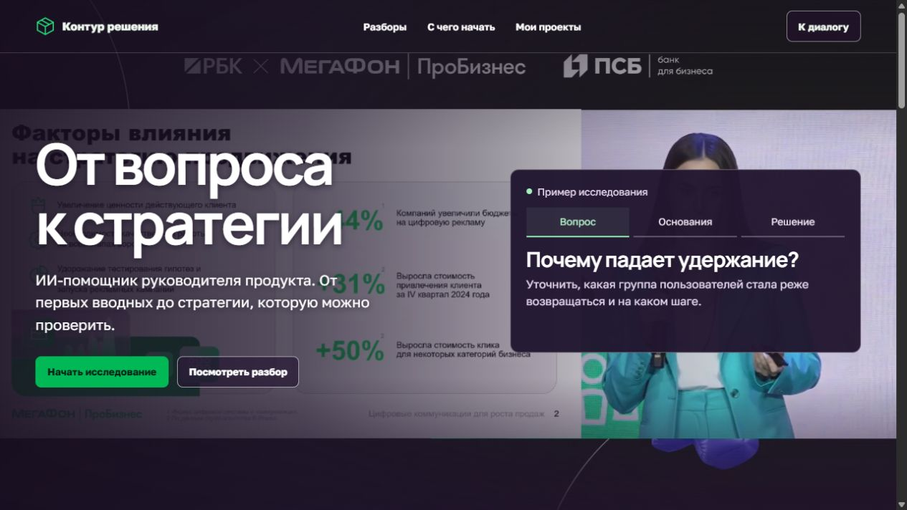
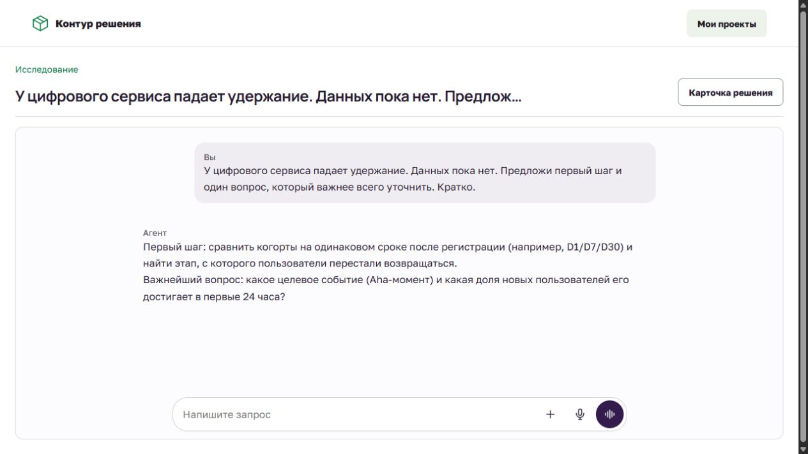
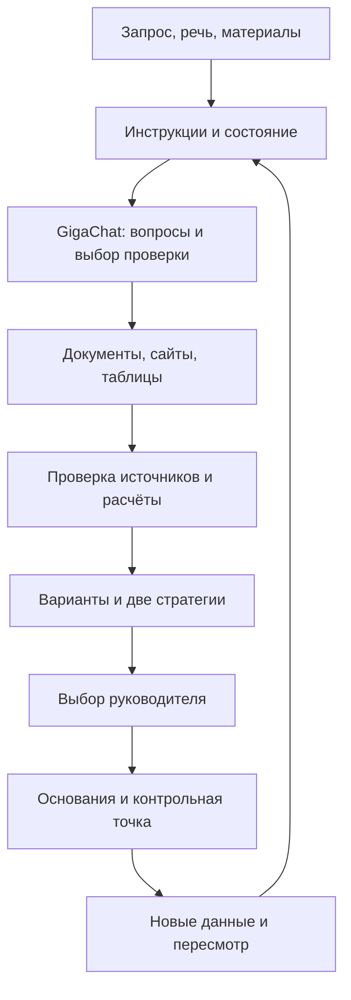
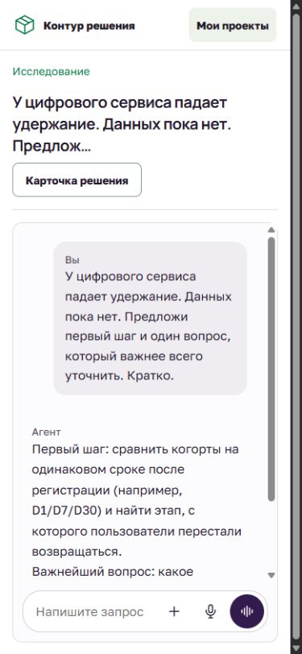

# Контур решения · Стратег Фабрики продуктов

Помощник руководителя цифрового продукта: от неясного вопроса до продуктовой и коммуникационной стратегии с основаниями, альтернативами и планом проверки. После выбора работа продолжается — сохраняются решение, материалы, ответственный и условие пересмотра.

Я делаю проект для трека «Стратег Фабрики продуктов» МегаФона. Мне было важно собрать рабочее пространство для исследования: с исходными материалами, проверяемыми расчётами, возможностью остановиться и вернуться к задаче. Сайт добавляет переписку, диктовку и голосовой разговор. Сам агент остаётся папкой с инструкциями, методиками, знаниями и инструментами, которую можно открыть в Codex или Cursor.



## Как посмотреть проект

**GitHub хранит код. Страница репозитория не запускает модель и голосовые процессы.** Для полной проверки нужно выполнить установку ниже. GitHub Pages для этого приложения недостаточно.

Есть два способа работы:

- В редакторе: откройте папку в Codex / Cursor, попросите прочитать [AGENTS.md](AGENTS.md), затем задайте продуктовый вопрос. Модель и доступы используются из вашего редактора. CLI-инструменты репозитория читают материалы и сохраняют состояние.
- В браузере: запустите собранный сайт и API. Для анализа используется GigaChat, для разговора и диктовки — отдельные речевые процессы на компьютере проверяющего. Компьютер автора после установки не требуется.

Для знакомства доступны [готовый учебный разбор](examples/procurement/result.md), [пересмотр решения](examples/procurement/review.md), [бриф](examples/procurement/brief.txt) и [исходная таблица](examples/procurement/cohorts.csv). Это сохранённые результаты проверки. Новый ответ на ваш вопрос генерируется подключённой моделью.

## Что происходит с задачей

1. Агент уточняет цель, предстоящее решение, ограничения и доступные данные. Вопрос должен менять следующий шаг исследования.
2. Читает документы, таблицы и разрешённые публичные страницы. У существенного наблюдения остаётся источник и фрагмент. Недоступный источник отмечается ошибкой.
3. Выбирает вопросы исследования и расчёты. Проверяет числитель, знаменатель, проценты, периоды и пропуски. Совпадение во времени не объявляется причиной изменения.
4. Сравнивает разные направления, включая сохранение текущего подхода и закрытие направления. Для каждого требуется сильное возражение.
5. Связывает продуктовую стратегию с коммуникационной: кому помогаем, что меняем, от чего отказываемся, как объясняем пользу и чем подтверждаем обещание.
6. Формирует план проверки с метрикой, сравнением, сроком и нежелательными последствиями. Существенный выбор подтверждает руководитель.
7. Сохраняет основания. При новых данных проверяет условие пересмотра и предлагает следующее действие ответственному.

Проверки структуры, чисел и согласованности снижают число ошибок, но не превращают любой ответ модели в доказанный факт. Пробелы в данных остаются пробелами.

## Интерфейс и история



В ленте остаются запрос, ответ, графики и значимые предупреждения. Журнал инструментов, счётчики токенов и тариф не выводятся между сообщениями. Основания и сведения о выполнении сохраняются в API-ответе и контрольной точке для проверки исследования.

Справа от поля ввода находятся вложение файла, диктовка и начало разговора. Во время звонка доступны выключение микрофона, прерывание ответа и завершение. Можно продолжать писать и отправлять ссылки. Оба режима используют одну аналитическую модель и одно состояние проекта. Сфера показывает состояние разговора; анимация сама по себе не доказывает, что речь распознана. Распознанная реплика видна в чате.

При первой установке нет подготовленных пользовательских чатов. Примеры лежат в `examples/` и не добавляются в «Мои проекты» автоматически. История браузера хранится в localStorage, вложения — в IndexedDB. Контрольные точки создаются в `cases/`, исключённой из Git.

На другом компьютере будут собственные хранилища. IP не используется для разделения истории: разные люди могут находиться за одним адресом. «Очистить историю» убирает проекты из списка этого браузера; предыдущий список сохраняется локально в `contour-projects-trash`. Кнопка не удаляет резервные дела с диска.

Поставка рассчитана на отдельную локальную установку. Для общего сервера нужны аутентификация и разделение серверного хранилища. Готовая многопользовательская эксплуатация не заявляется.

## Какие модели используются

| Роль | Проверочный профиль | Где работает |
| --- | --- | --- |
| Анализ, стратегии, диалог, разбор изображения | GigaChat-3-Ultra | API Сбера; ключ и доступная квота |
| Распознавание в разговоре | Русский Zipformer INT8 2025-04-20, sherpa-onnx | CPU проверяющего |
| Диктовка | Qwen3-ASR-0.6B-Q8_0.gguf, transcribe-cpp | CPU проверяющего |
| Быстрая озвучка | Silero v5.6 ru, eugene, WAV 48 кГц | CPU проверяющего |
| Расчёты, чтение материалов, память | Инструменты репозитория | Node.js проверяющего |

Название `voice/qwen_voice.py` историческое: текущий быстрый голос генерирует Silero. В коде сохранены альтернативные ветви Qwen TTS, Piper и Ollama, но для стандартного профиля жюри они не нужны.

Веса GigaChat не скачиваются: модель вызывается через API. Доступ к Ultra определяется кабинетом владельца ключа и проверяется перед демонстрацией. [Документация модели](https://developers.sber.ru/docs/ru/gigachat/models/gigachat-3-ultra).

Qwen 2B и 4B проверялись локально, однако не дали достаточного качества на новом стратегическом кейсе. Основной профиль поэтому использует GigaChat. Замена модели требует повторной приёмки, а не только изменения имени.

## Установка сайта и API

Проверочный профиль: Windows x64, Node.js 24, Python 3.11. Для Node-инструментов предусмотрен CI на Windows и Linux. Установка речи ниже рассчитана на Windows; речь на Linux/macOS этим выпуском не подтверждается.

Нужны интернет для скачивания зависимостей и GigaChat, место для Python-окружений и весов, микрофон для живой проверки. GPU выбранному CPU-профилю не обязателен. Задержка зависит от процессора, диска, сети и очереди провайдера.

```powershell
npm install -g pnpm@11.25.0
pnpm install --frozen-lockfile
pnpm build
```

### Настройка GigaChat

1. Создайте проект GigaChat API и Authorization key по [инструкции для физлиц](https://developers.sber.ru/docs/ru/gigachat/individuals-quickstart). Подписка на пользовательский чат не подтверждает доступ API к нужной модели.
2. Создайте файл вне репозитория, например `D:/ContourSecrets/gigachat.env`, со строкой `GIGACHAT_AUTH_KEY=ваш_ключ`. Не публикуйте ключ.
3. Скопируйте [шаблон конфигурации](config/runtime.example.env) в `.env.local` в корне проекта и укажите свой путь:

```dotenv
CONTOUR_LLM_BACKEND=gigachat
GIGACHAT_MODEL=GigaChat-3-Ultra
CONTOUR_CREDENTIALS_FILE=D:/ContourSecrets/gigachat.env
PORT=5176
```

При необходимости задайте `GIGACHAT_CA_FILE` с путём к официальному CA-файлу из документации Сбера. Проверка TLS включена; отключать её не нужно.

Текстовый режим можно проверить до установки речи:

```powershell
pnpm start
```

Откройте **http://127.0.0.1:5176**. Это собранное приложение и API без Vite. Для редактирования интерфейса доступен `pnpm dev --port 5175`.

### Установка речи

Установите Python 3.11 с [официального сайта](https://www.python.org/downloads/). Выберите папку для окружений и весов на доступном диске. Пути автора повторять не требуется.

Ознакомьтесь с [лицензией Silero](https://github.com/snakers4/silero-models/blob/master/LICENSE). Этот голос нельзя автоматически считать разрешённым для коммерческого внедрения. Если условия подходят для вашей проверки:

```powershell
powershell -NoProfile -ExecutionPolicy Bypass -File voice/setup.ps1 `
  -AiRoot D:/ContourRuntime `
  -PythonPath C:/Path/To/Python311/python.exe `
  -AcceptSileroLicense
```

Замените `-PythonPath` путём к своему Python 3.11. Если `python` уже указывает на него, параметр можно опустить. `ExecutionPolicy Bypass` действует только для запущенного процесса и не меняет системную политику.

Скрипт создаёт два изолированных окружения, устанавливает [ASR-зависимости](voice/requirements-asr.txt) и [TTS-зависимости](voice/requirements-tts.txt), скачивает веса и сверяет SHA-256 с [проверочным профилем](agent/jury-runtime.json). Несовпадение останавливает установку. GGUF для диктовки — сборка сообщества handy-computer на основе Qwen ASR, это отдельный источник от официальных весов Qwen.

Нужные речевые веса занимают примерно 1,07 ГБ без библиотек. Полные PyTorch-веса Qwen ASR/TTS и Ollama 4B не загружаются. Окружения и архивы требуют дополнительного места.

```powershell
powershell -NoProfile -ExecutionPolicy Bypass -File voice/start.ps1 -AiRoot D:/ContourRuntime
Invoke-RestMethod http://127.0.0.1:9460/health
Invoke-RestMethod http://127.0.0.1:9461/health
node agent/verify-portability.mjs D:/ContourRuntime/models
```

Оба сервиса должны вернуть `ready: true`. Они слушают только localhost и должны работать всё время разговора. Журналы находятся в папке runtime. Обновите сайт, разрешите микрофон и проверьте сначала диктовку, затем содержательный разговор. Браузер и операционная система должны разрешать звуковое воспроизведение.

## Материалы и ограничения

| Материал | Обработка | Граница |
| --- | --- | --- |
| TXT, Markdown, DOCX | Извлечение текста | До 2 МБ; длинные документы читаются выбранными фрагментами, покрытие указывается |
| PDF | Текстовый слой | Скан требует отдельного OCR, который не заявлен |
| CSV, XLSX | Таблица, проверка долей, график | Первый лист XLSX; табличное представление и графики ограничены 40 строками |
| PNG, JPEG, WebP | Передача мультимодальной модели | Одно изображение на запрос; числа сверяются с оригиналом |
| Ссылка | Чтение публичной страницы | До трёх ссылок; без закрытых, локальных и требующих входа страниц |
| VTT, SRT | Расшифровка с таймкодами | Это анализ расшифровки, не всего видео |
| Голос | WAV → ASR → анализ → WAV | До 80 секунд на серверный фрагмент; разговор состоит из отдельных реплик |

В интерфейсе доступны до пяти файлов по 2 МБ; суммарно до 2,65 МБ за запрос. Ошибка чтения не должна скрываться под видом выполненного исследования.

Поиск использует каталог источников и переданные ссылки. Полный поиск всего интернета не заявлен. Прямой анализ видеокадров и звуковой дорожки MP4 ещё не завершён. Вложение MP4 в чате как поддержанная возможность не предлагается.

## Архитектура и память



| Файл / папка | Назначение |
| --- | --- |
| AGENTS.md | Вход из редактора, правила исследования и продолжения |
| agent/instructions.md | Постоянные инструкции |
| agent/methods.md | Методические знания |
| agent/sources.json | Каталог открытых источников |
| server/materials.js | Документы, таблицы и публичные URL |
| server/research.js | Вопросы исследования и расчёт долей |
| server/strategy.js | Структура, проверка и исправление стратегического ответа |
| server/cases.js | Версии состояния и отдельные исходные материалы |
| server/monitor.js | Числовое условие пересмотра |
| voice/ | Речь и установка профиля |
| examples/ | Учебные материалы, результаты и тесты |

Контрольные точки накапливаются в `cases/<id>/checkpoints/`, материалы — в `cases/<id>/materials/`. При восстановлении проверяются путь, размер и хеш материала. Предыдущий ответ агента остаётся рабочей записью; фактом его делает исходное свидетельство.

```powershell
node agent/cli.mjs inspect examples/procurement/cohorts.csv
node agent/cli.mjs resume procurement-check
```

В новом чате редактора попросите прочитать AGENTS.md и продолжить нужное дело. Для переноса дела скопируйте всю его папку вместе с материалами. Реальные дела не публикуются автоматически.

### Поддержка после выбора

Карточка содержит выбор, основания, две стратегии, план проверки, ответственного, дату и условие пересмотра. Версии показывают изменения после новых сведений.

Монитор запускается с `pnpm start` или отдельно через `pnpm monitor`. Для дела явно включается `monitor.enabled`, задаётся `inbox` с CSV/XLSX в `cases/<id>/inbox/` и правило, например `Активация ниже 30%`. Пока процесс запущен, проверка работает и без открытого браузера. Автозапуск после перезагрузки ОС не настраивается.

Поддержан однозначный числовой порог для доли. Неоднозначный период или ошибка таблицы требуют человека. Уведомления хранятся в `monitorNotices` контрольной точки, повторы не создают дубль. Решение монитор не меняет. Центр уведомлений и универсальное качественное наблюдение за любыми сайтами не заявлены.

## Проверки и демонстрация

Без ключей и речевых весов:

```powershell
pnpm build
node agent/verify-analysis.mjs
node agent/verify-workflow.mjs
node agent/verify-monitor.mjs
```

Эти проверки включены в GitHub Actions для Windows и Linux. Они подтверждают сборку и поведение инструментов. Зелёный CI не является проверкой живого микрофона или экспертного качества стратегии.

При работающем приложении и доступе к модели:

```powershell
node examples/procurement/run.mjs http://127.0.0.1:5176
node examples/procurement/verify-image.mjs http://127.0.0.1:5176
node examples/procurement/verify-voice.mjs http://127.0.0.1:5176
```

Сквозной тест создаёт дело `procurement-check` с синтетическим выбором руководителя и пересмотром после новых данных. Не запускайте его поверх своего дела с тем же именем. Проверка речи использует синтезированную запись, не заменяет ваш микрофон. Для неё задайте `CONTOUR_VOICE_PYTHON` с путём к Python речевого окружения, если он отличается от указанного в скрипте.

| Проверка | Предмет проверки |
| --- | --- |
| Арифметика | Доли, нулевой знаменатель, несовпадение процента |
| Источники | Неверная цитата, недоступная ссылка, неполное чтение |
| Стратегия | Поля, варианты, возражения, ограничения обещаний |
| Память | Новый процесс, версии, конфликт сохранения |
| Материалы | Совпадение CSV/XLSX, отдельное хранение и хеш |
| Мониторинг | Порог, отсутствие дубля, ошибка и восстановление |
| Речь | Синтез → распознавание → ответ → синтез |

В кейсе закупок проверены 48/120 = 40%, 45/150 = 30%, изменение −10 процентных пунктов. Позднее 28/100 = 28% пересекло порог ниже 30%. Числа учебные, не являются данными МегаФона и не доказывают причинный эффект пилота.

В одном из прогонов подробный отчёт занял около 36,5 секунды. Отдельный короткий серверный вопрос — 2,392 секунды. Это разные задачи, не обещание постоянной задержки. Живой микрофон автор проверял отдельно и подтвердил содержательный звуковой ответ. Устройство жюри требует своей проверки.

## Расходы и качество

В проверках использована доступная владельцу Freemium-квота GigaChat. Пакеты и тарифы кодом не покупаются. Нулевая доплата внутри квоты не означает бесплатность навсегда: условия и баланс проверяются в кабинете.

API возвращает время, инструменты и usage, если провайдер его передал. Полная стоимость также включает поиск, повторы, электроэнергию, размещение и ручную проверку. Полное сравнение с аналитиком или обычным чатом пока не измерено; преимущество в процентах не заявляется.

Проверка согласованности выполняется в том числе той же аналитической моделью. Это полезный дополнительный проход, но не независимая экспертиза. Перед коммерческим обязательством нужны проверенные данные и решение человека. Широкий независимый benchmark, нагрузочная приёмка и гарантия отсутствия галлюцинаций не заявляются.

## Данные и безопасность

- Только открытые источники и собственные разрешённые материалы. Закрытые данные МегаФона не нужны.
- Ключи вне Git; .env, cases, Python-окружения и веса не публикуются.
- Источник не может изменять постоянные инструкции. Команды из документов не исполняются.
- Проверяются публичность URL и размер материалов; локальные и приватные адреса читать нельзя.
- Изображение передаётся GigaChat и удаляется из временного хранилища после обработки. Ошибка удаления сообщается.
- Модельные интервью синтетические и не подтверждают спрос. Реальные требуют согласия и исключения персональных данных.
- Сервер привязан к 127.0.0.1. Не открывайте его в интернет как готовый многопользовательский backend.

## Соответствие заданию

| Требование | Реализация / свидетельство |
| --- | --- |
| Папка агента и инструменты | AGENTS.md, agent/, server/, CLI |
| Постановка и исследование | Вопросы, источники, проверки, пробелы |
| Разные варианты и возражения | Структура ответа и учебный разбор |
| Две согласованные стратегии | Аудитория, экономика, обещание, доказательство, каналы |
| План проверки | Метрика, сравнение, срок, нежелательные последствия |
| Продолжение | Контрольные точки и resume |
| После решения | Карточка, версии, новые сведения, числовой мониторинг |
| Удобство и прозрачность | Диалог и голос, остановка, журнал и источники в результатах |
| Экономичность | Время и доступный usage; неизвестные затраты указаны |

Это карта связи с заданием, не прогноз оценки. Дополнительные компоненты выбираются по пользе; число агентов или библиотек само по себе преимуществом не считается.

## Что осталось для окончательной подачи

1. Проверить появление официального демонстрационного брифа и пройти его разрешёнными материалами.
2. Повторить запуск и живой разговор на независимом компьютере. Новое окружение на машине автора не равно другой машине.
3. Записать обязательное видео до 10 минут: запрос, инструменты, варианты, обе стратегии, пауза, продолжение, пересмотр.
4. Подготовить финальный PDF/документ со скриншотами, архитектурой, моделями, инструкциями, расходами, ошибками и помощью человека.
5. Проверить ссылки и отправить комплект капитаном через «Моя работа». Репозиторий сам по себе не отправляет заявку.

## Материалы и благодарности

Это не официальный продукт МегаФона. Одобрение компании не заявляется. Источники визуальных материалов — [megafon-sources.md](megafon-sources.md). Права на изображения, видео и логотипы сохраняются за правообладателями; их присутствие в учебном проекте не предоставляет коммерческую лицензию.

Оригинальные Network Lines и Image Flipper предоставлены из OriginKit. При распространении нужно учитывать условия их лицензии; авторские пометки сохранены. Для визуальной правки использован [Unslop](https://github.com/heydamir/unslop), Damir Sokolovsky, CC BY 4.0.

## Проверка передачи через GitHub · 19 ноября 2026

[GitHub Actions: успешный прогон на Windows и Ubuntu](https://github.com/blad3r81/contour-product-strategist/actions/runs/44551488998). Проверен код коммита `fe679ef2aa9f108b8083e3a17b84899bda12df1c`. После публикации репозиторий заново клонирован в отдельную папку, зависимости установлены по lockfile, выполнены сборка и проверки инструментов. Затем запущены реальная GigaChat и речь из новых Python-окружений с отдельно загруженными весами.

| Проверка после клонирования | Наблюдаемый результат |
| --- | --- |
| Сквозной кейс закупок | Все проверки скрипта прошли; отчёт за 29,829 с, график 40% → 30%, сильные возражения и две стратегии |
| Пауза и продолжение | Восстановлено решение; 28/100 = 28% пересекло порог 30%, предыдущий выбор сохранён |
| Изображение таблицы | Распознаны обе строки, шесть числовых значений; 2,66 с |
| Голосовая цепочка | Zipformer 0,886 с → содержательный ответ 2,799 с → Silero 0,971 с |
| Диктовка Qwen ASR | Первый вызов 29,06 с, повторный 7,86 с; осталась грамматическая ошибка в слове «пользователей» |

Подробные [машиночитаемые результаты](docs/acceptance/github-check-2026-11-19.json) сохраняют границы этих проверок. Время голосовой цепочки измерено после отправки готовой записи; браузерная пауза, микрофон и воспроизведение на устройстве жюри в эти числа не входят. Это проверка на той же физической машине с новым окружением. Во время подготовки исправлены кодировка установщика PowerShell и разрешение установочного скрипта esbuild; проблемы скачивания весов не скрывались под видом успешной установки.


