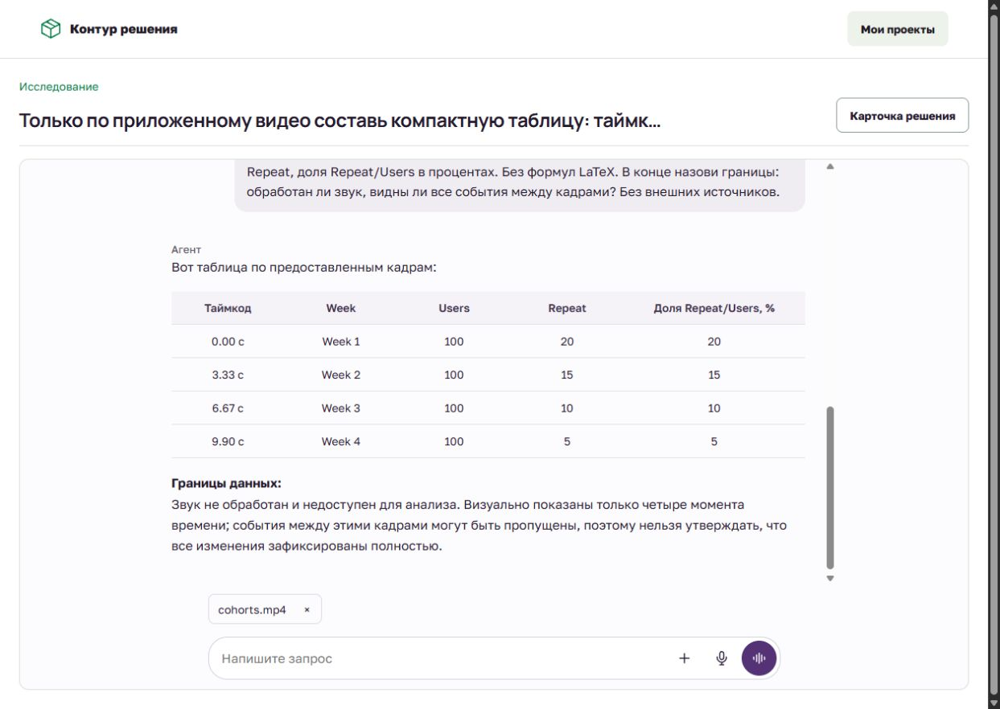

# Контроль публичной версии 22 ноября 2026

Эта проверка дополняет официальный демонстрационный проект. `cohorts.mp4` — специально созданный синтетический ролик длительностью 10 секунд, без звука. Четыре сцены показывают 100 пользователей и 20, 15, 10, 5 повторных действий. Это проверка чтения, а не данные МегаФона и не доказательство удержания реального продукта.

## Что проверено

Ролик прикреплён через обычную кнопку веб-чата на https://decision-contour.vercel.app . Браузер выделил кадры на 0,00; 3,33; 6,67; 9,90 секунды. Модель правильно прочитала четыре набора значений и рассчитала 20%, 15%, 10%, 5%. В ответе указаны ограничения выборки и отсутствие анализа звука. Точный запрос и видимая таблица сохранены в [browser-result.json](browser-result.json).



До исправления публичная модель один раз попросила повторно прикрепить видео, хотя коллаж уже был передан. Добавлена явная инструкция анализировать приложенный коллаж, когда пользователь говорит «видео». После исправления тот же запрос прошёл. Локальная первая попытка также выявила ошибку настройки тестового сервера: без выбранного онлайн-провайдера он пытался обратиться к недоступной локальной модели. Это не было засчитано как успешный тест.

Проверка границы: ролик длительностью 61 секунду остановлен в браузере с сообщением «Поддерживается видео длительностью до 60 секунд», без зависания и без анализа неподдержанного материала.

## Повторные проверки материалов и речи

[public-acceptance.json](public-acceptance.json) содержит фактические ответы публичного API, источники, графики и времена. Секреты и сеансовые cookies в файл не сохраняются.

| Проверка | Результат |
| --- | --- |
| CSV и XLSX | Прочитаны значения когорт, рассчитаны доли 40% и 30%, возвращены графики |
| Официальный PDF | Полное чтение всех 29 458 извлечённых символов; правильно названы 279 млн, 285 млн и разрыв 6 млн |
| Изображение | Прочитаны контрольные числа 120, 48, 40, 150, 45, 30 |
| Публичная ссылка megafon.ru | Страница прочитана, источник возвращён в ответе |
| Синтетическая голосовая цепочка | TTS → WAV → ASR → содержательный ответ → WAV; распознано «как проверить падение удержания пользователей» |

Синтетическая запись не заменяет проверку живого микрофона, разрешений браузера и субъективного качества голоса. Такая проверка ранее выполнена пользователем с содержательным звуковым ответом. Задержки остаются: в этом прогоне ASR занял 3,419 с, аналитический ответ 1,702 с, полная WAV-озвучка 10,184 с. Отдельный потоковый тест доставил первый MP3-фрагмент за 3,206 с, второй за 4,364 с; второй успел загрузиться до окончания первого. Эти измерения относятся к конкретным запросам, а не являются гарантией скорости.

Автоматические проверки расчётов, восстановления, мониторинга, ошибок полного чтения, конфигурации, сеансов и разбиения речи прошли повторно. Обязательный минимум подтверждается также официальным кейсом; одна эта таблица не доказывает качество любой стратегии.

## Воспроизведение

Для HTTP-проверок нужны доступная демонстрация и FFmpeg в PATH:

```sh
node agent/verify-public.mjs https://decision-contour.vercel.app
node agent/verify-cloud-stream.mjs https://decision-contour.vercel.app
```

Для пересоздания контрольного ролика нужны Python, Pillow и FFmpeg:

```sh
python examples/video-check/create.py
```

Переменная `FFMPEG` позволяет указать путь к установленному FFmpeg. Для браузерной проверки прикрепите `cohorts.mp4` и используйте запрос из `browser-result.json`.

## Границы видео

Только веб-чат, MP4/WebM до 2 МБ и 60 секунд, кодек должен поддерживаться браузером. На запрос — одно видео или изображение. Четыре кадра объединяются в один JPEG; размер кадра ограничен, мелкий текст может потеряться. Исходный ролик остаётся в браузере, коллаж передаётся внешней визуальной модели. Между кадрами возможны пропуски. Звуковая дорожка не распознаётся; для её текста приложите VTT/SRT. Прямая передача MP4 в CLI/API не равнозначна браузерной подготовке и не заявляется. Ссылка на видеохостинг не означает автоматическое скачивание и разбор ролика.
